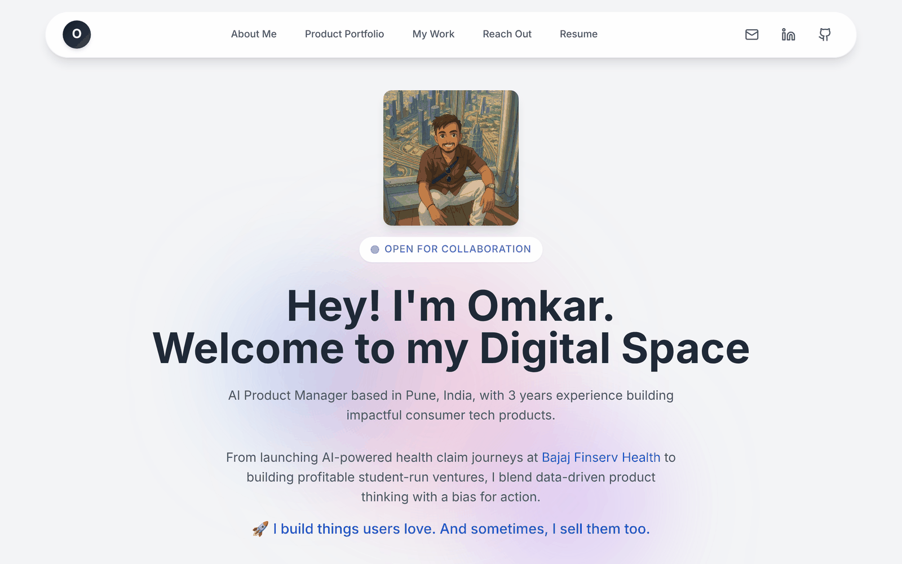
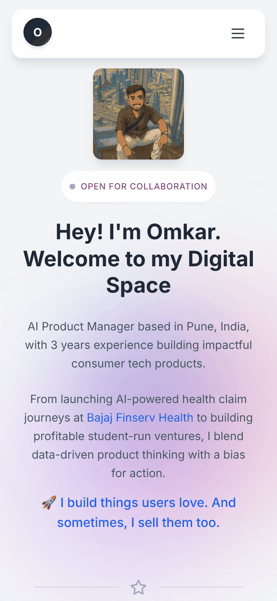

<div align="center">

# 👋 omkar.patil: personal portfolio

**My corner of the internet: product case studies, work history and the startups I've built.**

[](https://www.omkarpatil.in)


&nbsp;


</div>

---

## 2026 redesign

The live homepage is now a hand-built static page, served at `/` by a rewrite in `next.config.mjs`.

| Path | What it is |
|---|---|
| `public/index.html` | The current site (Naval hero, startups, itemised track record, experience, case studies, vibe-coded products) |
| `public/assets/` | Optimised screenshots, photos and the EZZ BILL walkthrough video |
| `public/versions/v1.html` … `v5.html` | Every redesign iteration, viewable at `/versions/v1.html` etc. |
| `app/v0-classic/page.tsx` | The original v0 portfolio, still live at `/v0-classic` |

Each iteration is also a git tag: `redesign-v1` to `redesign-v5`.

Case studies open as overlays and have shareable links: `/#ezzbill`, `/#bijlee`, `/#specxy`, `/#goldloop`, `/#oj-fitness`, `/#health-saathi`.

To edit the site, change `public/index.html` and push to `main`; Vercel redeploys automatically.

## What's inside

| Section | What you'll find |
|---|---|
| **About** | Who I am: an AI product manager in Pune who builds and sometimes sells what he builds |
| **Product portfolio** | Strategy case studies: Rapido × Metro, YouTube Premium Mini, CARS24 Partners, a foam-ball dispenser and Acropolis (NASA Ames finalist) |
| **Work timeline** | Bajaj Finserv Health, Viral Fission and EWar Games, with expandable impact bullets |
| **Startups** | Jersey Drip, Specxy (Hult Prize India runners-up) and Virtual Cricket Auctions |
| **Education** | ISB (Product Management), MIT Manipal (B.Tech IT) |
| **Outside work** | Badminton, treks, road trips, space, markets and Barça |

## Design notes

- **Scroll storytelling**: sections fade and slide in with Framer Motion. Clicking a company logo scrolls to the timeline and opens that role.
- **Horizontal and vertical portfolio carousels** so case studies feel like a deck, not a list
- **Collapsible job cards** that keep the timeline scannable while the detail stays one tap away
- Responsive from 360 px phones to wide desktops

## Tech stack

Next.js 14 (App Router) · React · TypeScript · Tailwind CSS · Framer Motion · shadcn/ui

## Run locally

```bash
git clone https://github.com/omkarpatilswork/Omi-Website.git
cd Omi-Website
pnpm install
pnpm dev     # http://localhost:3000
```

---

**Say hi:** [omkarpatilswork@gmail.com](mailto:omkarpatilswork@gmail.com) · [LinkedIn](https://www.linkedin.com/in/omkar-patil-757ab3194/)
