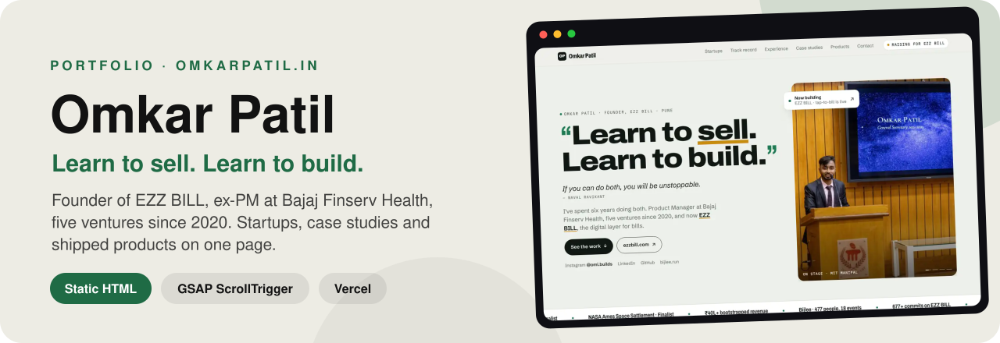
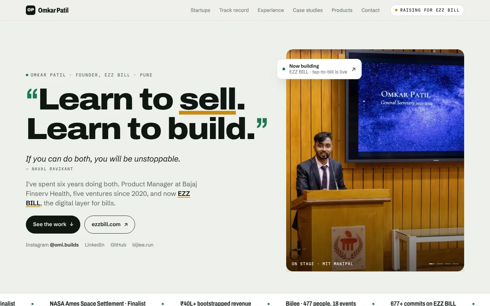
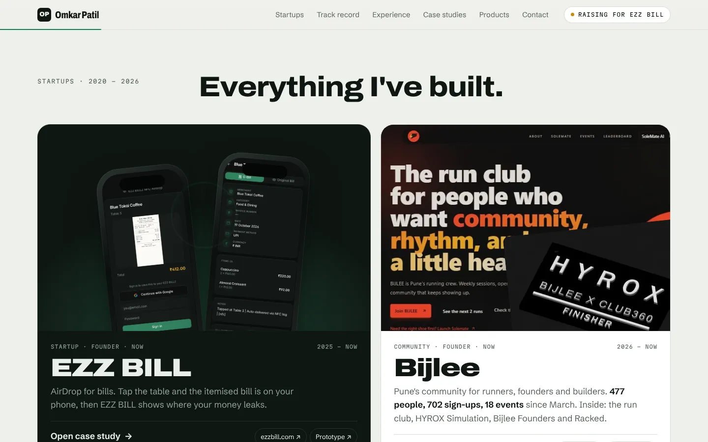
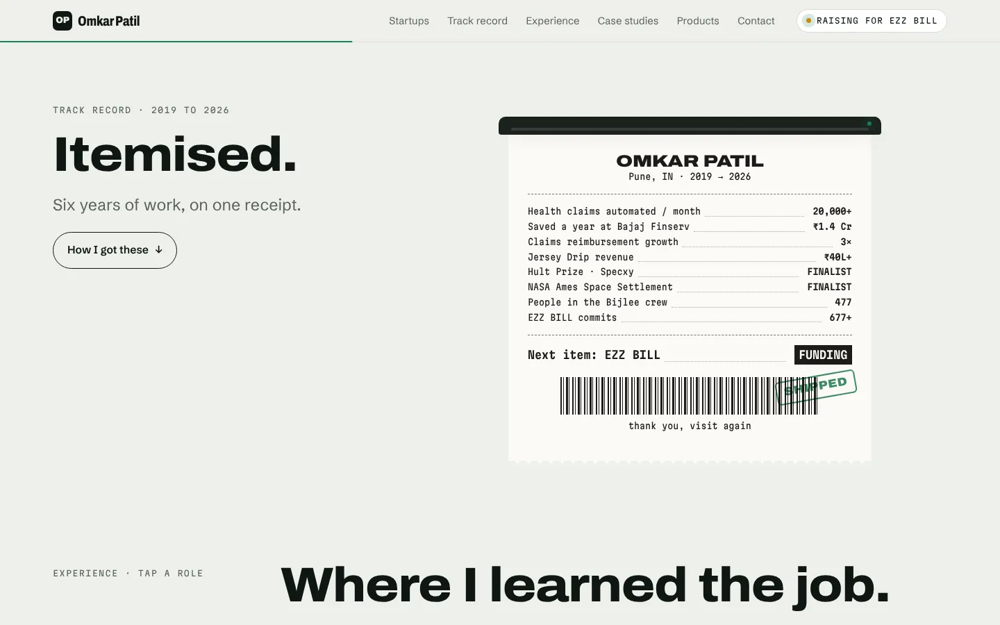
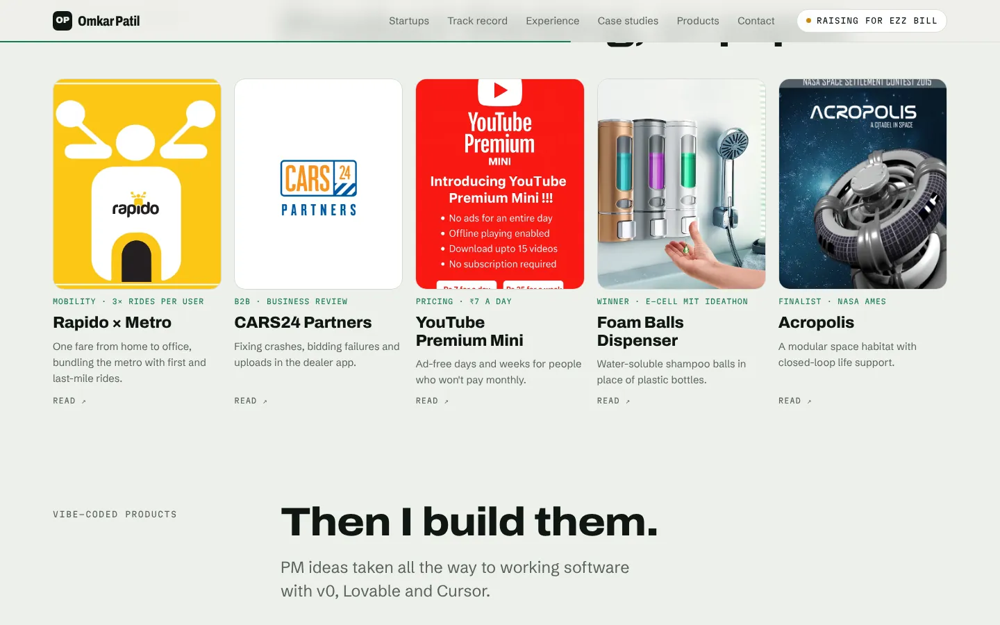
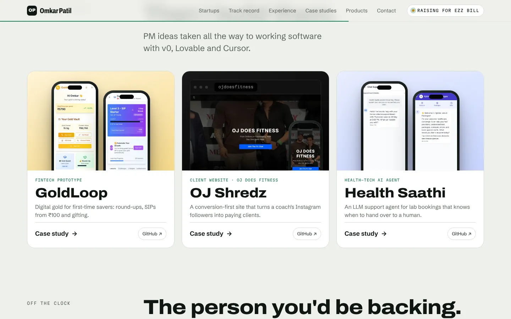
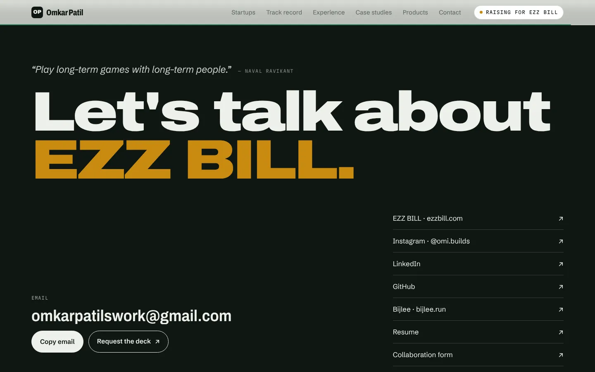
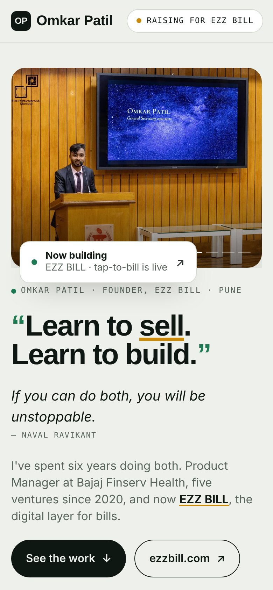
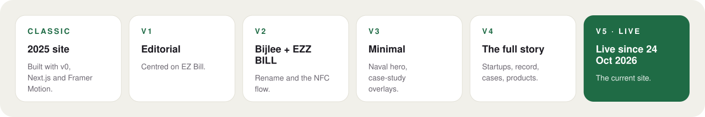

<div align="center">



<br/>

[](https://www.omkarpatil.in)
[](https://ezzbill.com)


**[What's on it](#01--whats-on-the-page)** ·
**[The page](#02--the-page)** ·
**[How it's built](#03--how-its-built)** ·
**[Design history](#04--design-history)** ·
**[Run it](#05--run-it-yourself)**

</div>

---

> *"Learn to sell. Learn to build. If you can do both, you will be unstoppable."* (Naval Ravikant)

---

## 01 · What's on the page

| Section | What you'll find |
|---|---|
| **Hero** | The Naval quote and the short version: PM at Bajaj Finserv Health, five ventures since 2020, now EZZ BILL |
| **Everything I've built** | Startups, with EZZ BILL and Bijlee featured, then Jersey Drip, Specxy and Virtual IPL Auctions |
| **Itemised** | The track record, laid out as a receipt |
| **Where I learned the job** | Bajaj Finserv Health, Viral Fission and EWar Games, with outcomes |
| **Product thinking, on paper** | Case studies: Rapido × Metro, CARS24 Partners, YouTube Premium Mini, the foam-ball dispenser and Acropolis |
| **Then I build them** | Products built with v0, Lovable and Cursor: GoldLoop, OJ Shredz and Health Saathi |
| **The person you'd be backing** | Life outside work, and education |
| **Let's talk about EZZ BILL** | Contact, and a request link for the investor deck |

Case studies open as overlays with shareable links: [`/#ezzbill`](https://www.omkarpatil.in/#ezzbill), [`/#bijlee`](https://www.omkarpatil.in/#bijlee), [`/#specxy`](https://www.omkarpatil.in/#specxy), [`/#goldloop`](https://www.omkarpatil.in/#goldloop), [`/#oj-fitness`](https://www.omkarpatil.in/#oj-fitness) and [`/#health-saathi`](https://www.omkarpatil.in/#health-saathi).

## 02 · The page

<table>
<tr>
<td width="50%"><br/><sub><b>Hero.</b> The quote, the one-paragraph story and links to the work and to EZZ BILL.</sub></td>
<td width="50%"><br/><sub><b>Everything I've built.</b> EZZ BILL and Bijlee up front, each opening a full case study.</sub></td>
</tr>
<tr>
<td width="50%"><br/><sub><b>Itemised.</b> Six years of work on one receipt.</sub></td>
<td width="50%"><br/><sub><b>Product thinking, on paper.</b> Five case studies.</sub></td>
</tr>
<tr>
<td width="50%"><br/><sub><b>Then I build them.</b> PM ideas taken all the way to working software.</sub></td>
<td width="50%"><br/><sub><b>Let's talk.</b> Email, socials, résumé and the deck.</sub></td>
</tr>
</table>

<div align="center">

<br/><sub>The same page on a phone.</sub>
</div>

## 03 · How it's built

| | |
|---|---|
| **One hand-built page** | [`public/index.html`](public/index.html) is the whole site. [`next.config.mjs`](next.config.mjs) rewrites `/` to it, so Vercel serves it as a single fast HTML file. |
| **Motion** | GSAP 3.12 with ScrollTrigger for the scroll-driven sections, and Lenis for smooth scrolling |
| **Type** | Archivo, Schibsted Grotesk and Martian Mono |
| **Assets** | Product screenshots, photos and an EZZ BILL walkthrough video in [`public/assets/`](public/assets) |
| **The 2025 site** | Still in the repo as a Next.js route, [`app/v0-classic/`](app/v0-classic) |

## 04 · Design history

Every iteration is kept, so you can see how the design changed:

<div align="center">

</div>

| Version | What changed |
|---|---|
| [Classic](https://www.omkarpatil.in/v0-classic) | The original 2025 site, built with v0, Next.js and Framer Motion |
| [v1](https://www.omkarpatil.in/versions/v1.html) | An editorial portfolio centred on EZ Bill |
| [v2](https://www.omkarpatil.in/versions/v2.html) | Added the Bijlee section, renamed to EZZ BILL, NFC flow from ezzbill.com |
| [v3](https://www.omkarpatil.in/versions/v3.html) | A minimal home page, the Naval hero, case studies as overlays |
| [v4](https://www.omkarpatil.in/versions/v4.html) | Startups, track record, experience, case studies and built products |
| [v5](https://www.omkarpatil.in/versions/v5.html) | The version that went live on 24 October 2026 |

To roll back the live site: in Vercel, open **Deployments**, pick the previous production deployment and click **Promote to Production**.

## 05 · Run it yourself

```bash
git clone https://github.com/omkarpatilswork/Omi-Website.git
cd Omi-Website
pnpm install
pnpm dev             # http://localhost:3000
```

The page itself is plain HTML, so `npx serve public` works too.

## Repository map

```
Omi-Website/
├── public/
│   ├── index.html          the live site, in one file
│   ├── versions/           v1–v5 of the 2026 redesign
│   └── assets/             screenshots, photos, walkthrough video
├── app/v0-classic/         the 2025 site (Next.js + Framer Motion)
├── next.config.mjs         rewrites / to public/index.html
└── docs/                   README screenshots and diagram
```

---

<div align="center">
<sub><b>Say hi:</b> <a href="mailto:omkarpatilswork@gmail.com">omkarpatilswork@gmail.com</a> · <a href="https://www.linkedin.com/in/omkar-patil-757ab3194/">LinkedIn</a> · <a href="https://www.instagram.com/omi.builds">@omi.builds</a></sub>
</div>
