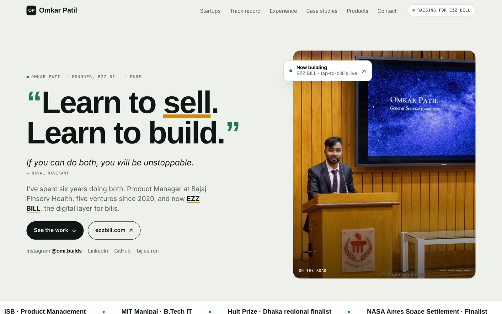

<div align="center">

# 👋 omkarpatil.in

**My portfolio: founder of EZZ BILL, ex-PM at Bajaj Finserv Health, five ventures since 2020.**

[](https://www.omkarpatil.in)


&nbsp;


</div>

---

> *"Learn to sell. Learn to build. If you can do both, you will be unstoppable."* (Naval Ravikant)

## What's on the page

| Section | What you'll find |
|---|---|
| **Hero** | The Naval quote, and the short version: PM at Bajaj Finserv Health, five ventures since 2020, now EZZ BILL |
| **Everything I've built** | Startups, with EZZ BILL and Bijlee featured, followed by Jersey Drip, Specxy and Virtual IPL Auctions |
| **Itemised** | My track record laid out as a receipt |
| **Where I learned the job** | Bajaj Finserv Health, Viral Fission and EWar Games, with outcomes |
| **Product thinking, on paper** | Case studies: Rapido × Metro, CARS24 Partners, YouTube Premium Mini, the foam-ball dispenser and Acropolis |
| **Then I build them** | Vibe-coded products: GoldLoop, OJ Shredz and Health Saathi |
| **The person you'd be backing** | About me, outside work |
| **Let's talk about EZZ BILL** | Contact, plus the investor deck |

Case studies open as overlays with shareable links: [`/#ezzbill`](https://www.omkarpatil.in/#ezzbill), [`/#bijlee`](https://www.omkarpatil.in/#bijlee), [`/#specxy`](https://www.omkarpatil.in/#specxy), [`/#goldloop`](https://www.omkarpatil.in/#goldloop), [`/#oj-fitness`](https://www.omkarpatil.in/#oj-fitness) and [`/#health-saathi`](https://www.omkarpatil.in/#health-saathi).

## How it's built

- **A hand-built static page.** `public/index.html` is the whole site, and `next.config.mjs` rewrites `/` to it, so Vercel serves it as one fast HTML file
- **Motion:** GSAP 3.12 and ScrollTrigger for scrollytelling, with Lenis for smooth scrolling
- **Type:** Archivo, Schibsted Grotesk and Martian Mono
- **Assets:** product screenshots, photos and an EZZ BILL walkthrough video in `public/assets/`

## Design history

Every iteration is kept, so the evolution of the design is visible:

| Version | What changed |
|---|---|
| [v1](https://www.omkarpatil.in/versions/v1.html) | An editorial portfolio centred on EZ Bill |
| [v2](https://www.omkarpatil.in/versions/v2.html) | Added the Bijlee section, renamed to EZZ BILL, NFC flow from ezzbill.com |
| [v3](https://www.omkarpatil.in/versions/v3.html) | A minimal home page, the Naval hero, case studies as overlays |
| [v4](https://www.omkarpatil.in/versions/v4.html) | Startups, track record, experience, case studies and vibe-coded products |
| [v5](https://www.omkarpatil.in/versions/v5.html) | The version that went live on 24 Oct 2026 |
| [Classic](https://www.omkarpatil.in/v0-classic) | The original 2025 site, built with v0, Next.js and Framer Motion |

To roll back the live site, open Vercel, go to **Deployments**, pick the previous production deployment and click **Promote to Production**.

## Run locally

```bash
git clone https://github.com/omkarpatilswork/Omi-Website.git
cd Omi-Website
pnpm install
pnpm dev     # http://localhost:3000
```

---

**Say hi:** [omkarpatilswork@gmail.com](mailto:omkarpatilswork@gmail.com) · [LinkedIn](https://www.linkedin.com/in/omkar-patil-757ab3194/) · [@omi.builds](https://www.instagram.com/omi.builds)
